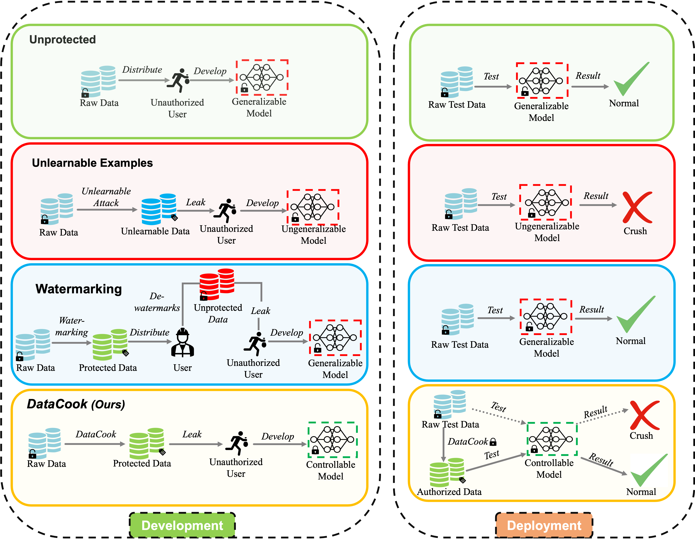

# DataCook
## Exploring Anti-Adversarial Fingerprints for Healthcare Data Usage Control

An official implementation of the paper _DataCook_. 

**Accepted by Meta-Radiology, 2026!** The open-access version of the paper can be downloaded from [Arxiv](https://arxiv.org/abs/2403.17755). **Feel free to clone our full project, test, and even make improvements on your own.** 

### Overview
<p align="justify">
DataCook explores deployment-stage healthcare data usage control using anti-adversarial fingerprints.

The framework applies a private cooking procedure to healthcare data before distribution. Models trained on cooked data can preserve predictive utility when evaluated on similarly cooked inputs, while their performance on raw inputs may be reduced.

We evaluate DataCook on 2D, 3D, and high-resolution medical images, as well as structured healthcare tabular data. The results demonstrate the feasibility of authorization-dependent model use in several settings, while highlighting important task- and metric-dependent limitations.

DataCook is presented as a proof-of-concept framework rather than a universally effective mechanism for preventing unauthorized data use.
</p>




---

## Table of Contents

- [Environment Setup](#environment-setup)
- [Dataset Preparation](#dataset-preparation)
- [How to Run Our Codes)](#how-to-run-our-codes)
- [Transfer Testing](#transfer-testing)
- [High-Resolution & 3D](#high-resolution--3d)
- [Baselines](#baselines)
- [Command-Line Arguments](#command-line-arguments)
- [Citation](#citation)
- [License](#license)
- [Contact](#contact)

---

## Environment Setup
```bash
# Create conda environment
conda create -n datacook python=3.8 -y
conda activate datacook

# Install required dependencies
pip install -r requirements.txt
```

---
## Dataset Preparation 
### 1. MedMNIST Datasets
We primarily use datasets from [MedMNIST](https://medmnist.com/ "https://medmnist.com/").
Please download them via the official Python API or manually place them under:
```bash
./data/MedMNIST/
```
Example:
```python
from medmnist import BloodMNIST
from torchvision import transforms

transform = transforms.Compose([transforms.ToTensor()])
train_dataset = BloodMNIST(split='train', transform=transform, download=True, root='./data/MedMNIST')
test_dataset = BloodMNIST(split='test', transform=transform, download=True, root='./data/MedMNIST')
```
---

### 2. Table Data
We also support **tabular datasets**. Please place them under:

```bash
./data/TableData/
```
| Dataset Name  | Download Link                       |
| ------------- | ----------------------------------- |
| Pima Indians Diabetes dataset  | [Using the ADAP Learning Algorithm to Forecast the Onset of Diabetes Mellitus](https://pmc.ncbi.nlm.nih.gov/articles/PMC2245318/) |
| Hepatitis C Prediction dataset | [UCI Machine Learning Repository](https://archive.ics.uci.edu/datasets) |
| Systemic Diseases dataset      | [UK biobank](https://pubmed.ncbi.nlm.nih.gov/25826379/) |

---

## How to Run Our Codes
**Example: Run DataCook on BloodMNIST (2D)**
```bash
# Step 1: Search perturbation noise
cd scripts/Datacook/2d/BloodMNIST
./search_perturbation_noise.sh

# Step 2: Train model with generated perturbations
cd scripts/Datacook/2d/BloodMNIST
./train.sh
```
You can follow the same format to add other datasets.

---
**Example: Run tabular datasets - systemic diseases.csv.**
```bash
# Step 1: pretrain model
cd TableData
python MLP.py

# Step 2: Generated perturbations and get result such as using datcook
python PrivacyAttacker.py --attack_type datacook
```

## Transfer Testing
To test transferability on another model (e.g., from ResNet-18 to ResNet-50),
modify the `model_name` argument in `train.sh`:
```bash
model_name=resnet50
```

---

## High-Resolution & 3D
For high-resolution and 3D datasets, see:
```bash
scripts/Datacook/high-resolution/
scripts/Datacook/3d/
```
---

## Baselines

We provide the following baselines in `scripts/`:

* Error-Minimum - [**EM**](https://arxiv.org/abs/2101.04898 "Unlearnable Examples: Making Personal Data Unexploitable") And modified verison of **EM** in our paper, called **EM-Pseudo**
* Adversarial Poison - [**ADV**](https://arxiv.org/abs/2106.10807 "Adversarial Examples Make Strong Poisons")
* Unlearnable Clusters - [**UC**](https://arxiv.org/abs/2301.01217 "Unlearnable Clusters: Towards Label-agnostic Unlearnable Examples")
* Synthetic Perturbations - [**LSP**](https://arxiv.org/abs/2111.00898 "https://arxiv.org/abs/2111.00898")

---

## Command-Line Arguments
All major hyperparameters can be set via command-line arguments in the provided `.sh` scripts.
Please refer to each `train.sh` or `search_perturbation_noise.sh` file for details.

---

## Citation
If you use this code, please cite the following:

@misc{shang2026datacook,
  title = {DataCook: Exploring Anti-Adversarial Fingerprints for Healthcare Data Usage Control},
  author = {Shang, Sihan and Yan, Jun and Shi, Danli and Zheng, Haizhong and Zheng, Shuangjia and Zhao, Wei and Yang, Jiancheng},
  year = {2026},
  eprint = {2403.17755},
  archivePrefix = {arXiv},
  primaryClass = {cs.AI},
  url = {https://arxiv.org/abs/2403.17755},
  note = {Accepted for publication in Meta-Radiology}
}

> We adapted some codes from:
> * [Unlearnable Examples](https://github.com/HanxunH/Unlearnable-Examples)
> * [Unlearnable Clusters](https://github.com/jiamingzhang94/Unlearnable-Clusters)

## License
This project is licensed under the MIT License.

## Contact
For any questions or collaborations, please contact:
**Max Shang** – [loveligo97@gmail.com](loveligo97@gmail.com)


